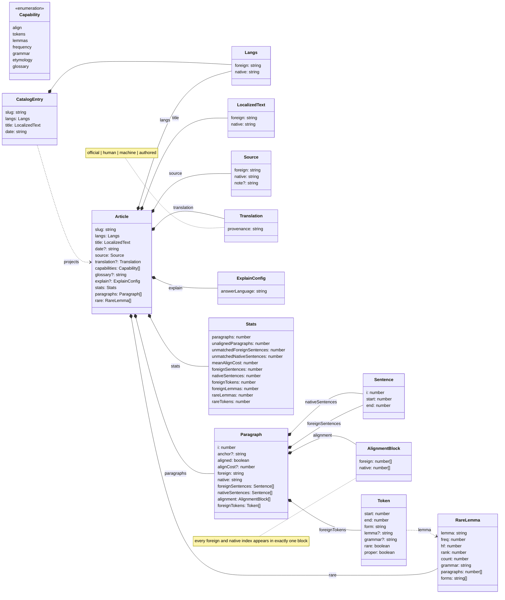
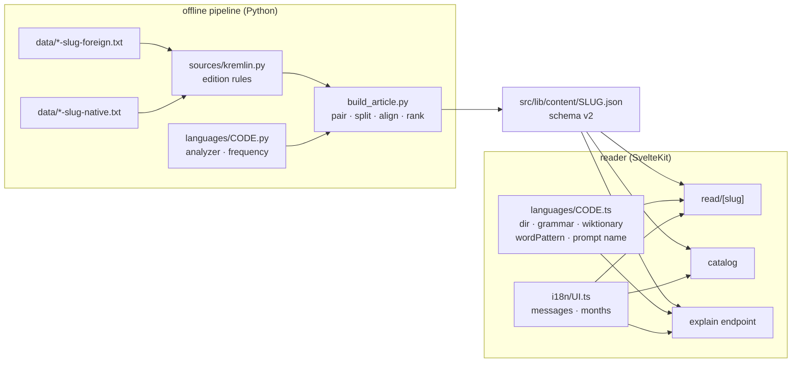
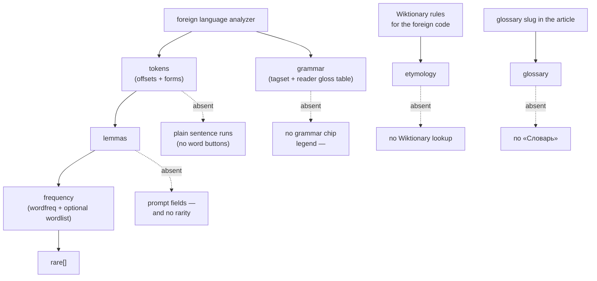

# Spec: the reader speaks native and foreign, not English and Russian

Status: ready-for-agent
Date: 2026-10-25
Feature slug: `multilanguage-reader`
Decided by grilling, 2026-10-25 (Q1–Q8, Q5b, Q7b — see Comments). This spec renames the two sides of the
reader to the roles they already play, makes the pair a property of each article, and lands the seams a
second language pair needs. It ships no second pair and no second-language content.

## Problem Statement

The reader is one hardwired pair, and the pair is encoded in names rather than data.

- The article contract is bimorphic by field name: `ArticleTitle { ru, en }`, `ArticleSource { ru, en }`,
  `Paragraph { ru, en, ruSentences, enSentences, pairs, ruTokens }`, `SentencePair = [ru, en[]]`
  (`src/lib/article.ts:12-83`). The pipeline emits exactly that shape
  (`scripts/build_article.py:530-561`), and the dumps carry it in their filenames
  (`data/*-<slug>-{ru,en}.txt`).
- The *foreign* side is the text being learned (Russian, the article pane); the *native* side is the
  aid (English, the translation). Yet the interface, the hints, the glossary and the model’s answers are
  all in the **foreign** language: `<html lang="ru">` (`src/app.html:2`), «Тексты» / «Слова» /
  «Словарь» (`src/lib/components/MenuBar.svelte:97-152`), «Русский текст — читаем с переводом»
  (`src/routes/+page.svelte:9`), and `prompts/word.md:16-19` — “The whole answer is in Russian”.
- Only the foreign side is tokenised, lemmatised and ranked: the Cyrillic `TOKEN` regex, pymorphy3,
  `zipf_frequency(…, "ru")` and `ru_full.txt` (`scripts/build_article.py:140,370-371,499-507`). The
  native side is sentence-split and aligned, never analysed.
- The alignment is stored one way only: one row per foreign sentence, `[ru, [en…]]`
  (`scripts/build_article.py:474-481`). The dual view — one row per native sentence — is computable
  but not represented; `enRangeFor` and `sentenceIndex` are keyed to the foreign side
  (`src/lib/article.ts:183-199,250-257`).
- The glossary’s native side *is* English Wiktionary text and English is its join key
  (`scripts/build_glossary.py:92-100`; `fold()` keeps `[a-z0-9]` only,
  `scripts/glossary_appendix.py:283-286`).
- No language, script or direction is carried anywhere: no `dir`, one font stack
  (`src/app.css:14-16`), and the explanation endpoint hardcodes `ru.wiktionary.org`
  (`src/routes/read/[slug]/explain/+server.ts:37`) and the «Этимология» heading
  (`src/lib/explain-server.ts:225-245`).
- Nothing in `src/`, `docs/` or `prompts/` uses the words native, foreign, target or L1/L2. The only
  forward statement is `GOAL.md:46`: “Later: make it a general Foreign language reader.”

The result: a second pair is not data — it is a fork. And the same two texts cannot be read reversed
(English article, Russian aid) without a rebuild of the whole foreign-side stack, because “foreign” and
“Russian” are the same thing in every name.

## Solution

Every article declares a **pair**: `langs: { foreign, native }`. Every field, component, route and
prompt is named by **role** — `foreign` is the text being learned and the article pane, `native` is the
language the reader already reads and the translation — while the actual language codes stay in the
payload and drive `lang`, `dir`, scripts, analyzers and Wiktionary editions. The alignment is stored as
role-neutral blocks, so neither side is the row key. Each article declares its **capabilities**, so the
reader hides what a language’s tooling did not produce instead of lying about it. The pipeline and the
reader each get a per-language descriptor registry; `ru` is implemented, `en` is metadata-only, and the
interface language becomes a deployment setting.

No new production content, no second foreign language, no new analyzer dependency. The proof that the
model is real is a dev-only handcrafted article with the roles reversed: English article, Russian aid.

## User Stories

1. As a reader of any pair, I want the article in the language I am learning and its translation in the
   language I already read, so that the panes mean the same thing whatever the pair is.
2. As a reader, I want the page to declare the right `lang` and direction for each pane, so that screen
   readers, hyphenation and fonts behave.
3. As a reader, I want the interface to speak one language consistently, so that chrome and content do
   not fight.
4. As a reader of an article whose language has no lemmatiser, I want the text to stay readable and the
   controls that need lemmas to be absent rather than broken.
5. As a reader, I want to be told when the native side is an official translation, a human translation,
   a machine translation, or authored for the article, so that I can weigh it.
6. As a reader of the same two texts, I want the option to read the English side as the article and the
   Russian side as the aid, so that the tool can be used in the direction I need.
7. As a maintainer, I want to add a language by writing a descriptor and content, not by renaming
   fields, so that “multilanguage” is a property of the data.
8. As a maintainer, I want one alignment representation that both directions can read, so that the
   correspondence has one source of truth.
9. As a maintainer, I want the interface strings in a message table, so that a second interface
   language is a translation, not a component edit.
10. As a maintainer, I want the prompt to take language names and a tag legend as values, so that one
    template serves every pair.

## Implementation Decisions

### Roles and vocabulary

- **`foreign`** = the language being learned; the article’s own text; the left pane.
- **`native`** = the language the reader already reads; the translation side; the right column.
  “Native” is documented as the reader’s known/bridge language, not necessarily their mother tongue.
- Code identity is by role only: `RuToken` → `Token`, `ruRuns` → `foreignRuns`,
  `PairGroup { ru, en }` → `AlignmentBlock { foreign, native }`, `enRangeFor` → removed in favour of
  `blockFor`, `RussianPane` → `ArticlePane`, `TranslationPane` → `ParagraphPane` (the names
  `GLOSSARY.md` already uses for those panes), CSS `.pane-ru`/`.pane-en`/`.en*` →
  `.pane-foreign`/`.pane-native`/`.native*`, and the `RU`/`EN` tags are rendered from
  `langs.foreign`/`langs.native` (`code.split('-')[0].toUpperCase()`), not from literals.
- `GLOSSARY.md` gains **Foreign language**, **Native language**, **Pair**, **Capability** and
  **Provenance**, and rewrites **Article**, **Sentence pair**, **Alignment**, **Merge**, **Split**,
  **Pair group**, **Prompt** and **Glossary** in role terms. The prose definitions stop saying “Russian
  side” and “English side”.

### Article payload (schema v2, clean cutover)

```json
{
  "slug": "66181",
  "langs": { "foreign": "ru", "native": "en" },
  "title": { "foreign": "Статья Владимира Путина …", "native": "Article by Vladimir Putin …" },
  "date": "2021-07-12T17:00+03:00",
  "source": {
    "foreign": "http://kremlin.ru/events/president/news/66181",
    "native": "http://en.kremlin.ru/events/president/news/66181"
  },
  "translation": { "provenance": "official" },
  "capabilities": ["align", "tokens", "lemmas", "frequency", "grammar", "etymology", "glossary"],
  "glossary": "glossary-ru",
  "explain": { "answerLanguage": "ru" },
  "stats": {
    "paragraphs": 88, "unalignedParagraphs": 13,
    "unmatchedForeignSentences": 0, "unmatchedNativeSentences": 0,
    "meanAlignCost": 0.112,
    "foreignSentences": 373, "nativeSentences": 360,
    "foreignTokens": 5238, "foreignLemmas": 1805,
    "rareLemmas": 200, "rareTokens": 233
  },
  "paragraphs": [{
    "i": 1, "aligned": true, "alignCost": 0.123,
    "foreign": "…", "native": "…",
    "foreignSentences": [{ "i": 0, "start": 0, "end": 142 }],
    "nativeSentences": [{ "i": 0, "start": 0, "end": 152 }],
    "alignment": [{ "foreign": [0], "native": [0] }],
    "foreignTokens": [
      { "start": 0, "end": 7, "form": "Недавно", "lemma": "недавно",
        "grammar": "ADVB,perf", "rare": false, "proper": false }
    ]
  }],
  "rare": [{ "lemma": "иерарх", "freq": 2.83, "hf": 2, "rank": 187, "count": 1,
             "grammar": "NOUN,anim,masc plur,gent", "paragraphs": [22],
             "forms": ["иерархов"] }]
}
```

- `date`, `anchor`, `source.note`, `glossary`, `explain.answerLanguage` and `translation` are optional
  per article; the rest are required. The glossary article has no `date` and provenance `authored`.
- `source` keeps its free-text `note` (the licence text) separate from `translation.provenance`.
- `rare[].hf` remains emitted even though the TS `RareLemma` interface does not use it; the interface
  gains `hf` rather than silently dropping a committed value.
- Old fields are deleted, not aliased. `pairs`, `ru`, `en`, `ruSentences`, `enSentences`, `ruTokens`,
  `ruLemmas` and the old stats names do not survive the cutover.
- `articles.json` entries become `{ slug, langs, title: { foreign, native }, date }`; the catalog groups
  by pair and renders `title.foreign` (as today). The reader’s `<title>` is `title.foreign`; the meta
  description is `title.native`.

### Data structures

#### The article graph

The diagram is the contract; the JSON above is one instance. `?` marks an optional field. `Token` and
`Sentence` carry character offsets into their own side’s paragraph string (`foreignTokens` into
`foreign`, `nativeSentences` into `native`); `AlignmentBlock` carries sentence **indices**, not objects,
so it stays a pure partition.



#### Where the language data lives

Two registries, one per runtime, and the payload as the only shared artifact. The build side owns
tooling (analyzer, frequency, source edition rules); the reader side owns presentation (script,
direction, grammar glosses, Wiktionary rules, word pattern, messages). Neither imports the other, so the
pair is declared twice in metadata and once in the content — which is why the capability list is checked
against the payload, not inferred from either registry.



#### What a capability unlocks

The pipeline derives each capability from what the foreign language and the article actually produced;
the reader only consumes the declared list. The dotted nodes are the degradation when the input is
absent.



### Alignment as role-neutral blocks

- `Paragraph.pairs` is replaced by `Paragraph.alignment: AlignmentBlock[]`:
  `{ foreign: number[]; native: number[] }`, one block per DP move, in path order (which is reading
  order on both sides).
- Each block holds contiguous runs on both sides. Every foreign index and every native index appears in
  exactly one block; unmatched foreign sentences are blocks with an empty `native`, and unmatched native
  sentences are blocks with an empty `foreign`. This partition is the representation’s invariant.
- The DP is unchanged numerically. Its move names become role terms: merge = several foreign sentences
  into one native; split = one foreign sentence across several native; `GAP_FOREIGN` = 0.9,
  `GAP_NATIVE` = 0.75; the length ratio is foreign:native (`scripts/build_article.py:126-138`). This
  keeps the committed alignment identical for the current pair while making the roles explicit.
- Reader helpers:
  ```ts
  export interface AlignmentBlock { foreign: number[]; native: number[] }
  export function blockFor(p: Paragraph, foreignSentence: number): AlignmentBlock;
  export function pairGroupFor(p: Paragraph, foreignSentence: number): AlignmentBlock;
  ```
  `blockFor` is a scan over `alignment`; `pairGroupFor` is kept as the pane’s name and returns the same
  block. `enRangeFor` is deleted; the paragraph pane marks `block.native` (a list) instead of a range.
  Selection remains foreign-only: `Selection.sentence` indexes `foreignSentences`, and `Tab` steps the
  foreign side. This is not a direction toggle — reversal is a different article whose `langs` are
  swapped.
- A test asserts the partition invariant and the expected groups of the committed articles. The old
  `pairs` in git are the reference for a one-off comparison during the cutover: the components derived
  from old `pairs` (by the old fixed point) must equal the new `alignment` blocks on all three
  articles.

### Reader-side language registry

`src/lib/languages/` is the reader’s per-language data. One module per code, plus a registry with a
fallback for unknown codes:

```ts
export interface LanguageInfo {
  code: string;
  name: string;          // endonym, shown in pair headings
  promptName: string;    // "Russian", used inside the prompt
  script: string;        // "Cyrl", "Latn", …
  dir: 'ltr' | 'rtl';
  wordPattern?: RegExp;  // words clickable in the explanation pane's prose
  grammar?: {
    gloss(uiLang: string, tag: string): string;   // popup; falls back to the raw tag
    promptLegend(tag: string): string;            // English, for the prompt
    entryByCode: Record<string, string>;          // tag code → glossary anchor
  };
  wiktionary?: {
    edition: string;                               // "ru" → ru.wiktionary.org
    etymologyHeadings: string[];                   // ["Этимология"]
    stubPatterns: string[];                        // "Происходит от ??", …
  };
}
```

- `ru.ts` absorbs `src/lib/grammar.ts` (the OpenCorpora gloss table, now keyed by UI language) and the
  moved `src/lib/grammeme-entries.json` (renamed `ru.entries.json`), plus the Russian Wiktionary
  heading/stub rules and the Cyrillic `wordPattern`.
- `en.ts` is metadata only: endonym, prompt name, Latn, ltr. No grammar, no Wiktionary rules unless
  added later.
- Unknown codes resolve to `{ code, name: code, promptName: code, script: '', dir: 'ltr' }`; components
  use `code` for `lang` and the fallback `dir`.
- A wrong entry in `entryByCode` stays the failure it is today: `scripts/check_glossary.py` checks it
  against the built glossary’s anchors.

### Interface language

- **One interface language per deployment**: `UI_LANG` (private env), default `ru`. The catalog has no
  article to take a language from, and an interface is one language; a single setting is the boring
  design. A French-facing deployment sets `UI_LANG=fr` when a `fr` table exists.
- `src/lib/i18n/` holds a typed `Messages` interface and `ru.ts`; `resolveUiLang(code)` returns `ru`
  when the table is missing or the value is empty. `+layout.server.ts` returns
  `{ uiLang: resolveUiLang(env.UI_LANG) }`; the root layout exposes it through context; components read
  the messages through a `t` helper rather than passing strings down.
- `src/app.html` becomes `<html lang="%lang%">`; `hooks.server.ts` replaces `%lang%` with the resolved
  code in `transformPageChunk`. The reader sets each pane’s `lang` from `langs.foreign`/`langs.native`
  and `dir` from the registry.
- All user-visible strings move into the message table: catalog copy, menubar labels and titles, pane
  aria-labels, legends, empty states, the no-translation note, sentence-count plurals, explanation
  statuses and errors, provenance labels, and months. The endpoint’s `ExplainError.message` is now “in
  the UI language”, read from `UI_LANG` on the server.
- Catalog copy stops naming Russian: «Текст на иностранном языке — читаем с переводом» /
  «Текст на иностранном языке с переводом»; the lede’s two sentences keep their meaning. Date
  formatting moves out of `article.ts` into the i18n layer (`formatDate(iso, uiLang)`); a UI language
  without month names falls back to `YYYY-MM-DD`.
- No translation of the interface into another language ships in this milestone; the `ru` table is the
  only one.

### Build-side language descriptors and the source seam

`scripts/languages/`:

```python
@dataclass(frozen=True)
class Language:
    code: str
    name: str            # endonym
    prompt_name: str     # English, for the prompt
    script: str
    direction: str
    analyzer: Analyzer | None      # tokens(text) -> Token list, or None
    frequency: Frequency | None    # zipf(lemma, forms), wordlist default
    abbreviations: tuple[str, ...] # sentence-splitting additions
```

- `ru.py` is the current pipeline moved verbatim: Cyrillic token regex, pymorphy3 first parse, lemma,
  tag, proper grammemes, `zipf_frequency(…, "ru")`, default `data/wordlists/ru_full.txt`, tagset
  `opencorpora`, Cyrl, ltr. No behaviour change.
- `en.py` is metadata only — no analyzer, no frequency. It exists so the native code resolves and so a
  future English-foreign article has a place to grow.
- `scripts/sources/kremlin.py` absorbs the dump rules that are today keyed to a language but are really
  kremlin.ru edition rules: date parsing, body-end markers, signature stripping, title and source URL
  derivation (`scripts/build_article.py:52-56,145-182,299-358`). `build_article.py` keeps paragraph
  pairing, sentence splitting, alignment, rarity and emission. Source generalisation beyond this move
  is out of scope.
- CLI: the slug stays the positional argument; `--foreign` and `--native` are required;
  `--translation-provenance {official,human,machine,authored}` is required; `--answer-language
  {foreign,native}` defaults to `foreign`; `--wordlist` defaults to the foreign descriptor’s wordlist;
  `--count` and `--out` keep their meanings. The dumps are found as
  `data/*-<slug>-<foreign>.txt` and `data/*-<slug>-<native>.txt`; the old requirement of exactly one
  dump per side and equal paragraph counts stays (`scripts/build_article.py:343-349,372-379`).
- Rarity runs only when the foreign language has both an analyzer and a frequency source; otherwise
  `rare` is absent and the capability is not declared. A frequency source without a wordlist ranks on
  zipf alone (`hf` 0). `wordfreq` and `FrequencyWords` remain the two sources.

### Capabilities

`capabilities` is the article’s declaration of what produced its data; the reader must not infer by
probing for fields. The pipeline derives it, and a test checks it against the payload.

| Capability | Present when | Reader and endpoint when absent |
| --- | --- | --- |
| `align` | always | not a reader without it |
| `tokens` | `foreignTokens` with offsets | article pane and sentence pane render plain sentence runs; no word buttons; no article-word explanation |
| `lemmas` | every token has a `lemma` | clicks still carry the surface form; lemma fields are `—`; no rarity |
| `frequency` | `rare[]` with zipf/rank | prompt gets `—` for zipf, rank, forms; nothing visual changes (rarity is not rendered) |
| `grammar` | tokens carry tags and the foreign language has a grammar module | no grammar chip; prompt legend is `—` |
| `etymology` | the foreign language has Wiktionary rules | no Wiktionary lookup or link; the model answers from its own knowledge |
| `glossary` | `glossary` names an article | no chip links and no «Словарь» entry in the menubar |

- The sentence pane and article pane gain a no-token path built on `sentenceRuns`, so a tokenless
  article stays fully readable.
- The menubar hides «Словарь» when the current article has no `glossary`, rather than linking a
  glossary for the wrong language.

### Translation provenance

- `translation.provenance` is one of `official`, `human`, `machine`, `authored`, written by the
  pipeline and required at build time. The kremlin.ru articles are `official`; the glossary is
  `authored`.
- The article header renders the provenance as a muted label in the UI language, beside the sources:
  «официальный перевод», «перевод человека», «машинный перевод», «написано для этой статьи». The
  `machine` label carries a title saying it was produced offline and is not authoritative.
- Machine translation at read time remains forbidden (`ADR-0001`); nothing in this milestone calls a
  model in the pipeline.

### Explanation endpoint and prompt

- **Answer language per article**: `explain.answerLanguage`, a resolved code, defaulting to the
  foreign language. The endpoint reads it from the article; the answer pane and origin pane set `lang`
  from it; the prose word pattern comes from that language’s module.
- **One prompt template**, `prompts/word.md`, in English (the instruction language is not a product
  axis). `prompts/word.ru.md` is deleted, along with the `EXPLAIN_PROMPT_PATH` convention of switching
  instruction languages. `EXPLAIN_PROMPT_PATH` remains a file override, defaulting to
  `prompts/word.md`.
- New placeholders, in addition to the existing eleven: `{{foreign_language}}`, `{{native_language}}`,
  `{{answer_language}}`, `{{grammar_legend}}`, `{{translation_label}}`. The template’s opening becomes
  “You are explaining one {{foreign_language}} word to someone who is learning {{foreign_language}} and
  reads {{foreign_language}} texts”; it asks for the answer “in plain {{answer_language}}”; it says a
  dash means the value is unknown. No Kremlin, no pair names, no hardcoded register language.
- `{{translation_label}}` is built from provenance and the native prompt name: “Official English
  translation”, “Human English translation”, “Machine English translation”, “English side authored for
  this article” (the last for `authored`).
- `{{grammar_legend}}` is the foreign language module’s `promptLegend(tag)`; `—` when the article has no
  `grammar` capability. The chip popup uses `gloss(uiLang, tag)`.
- `NO_DATA` changes from «нет данных» to `—` in `src/lib/explain-server.ts:15`; the prompt explains the
  dash. The prompt’s `{{date}}` is the ISO date (unambiguous for the model); the reader still formats
  dates for display.
- `explain-server.ts` reads `foreignTokens`, `foreignSentences`, `blockFor`, `title.foreign` and
  `article.langs`; `englishFor` becomes `nativeFor` over the block.
- **Etymology** follows the foreign language: the default URL is
  `https://<langs.foreign>.wiktionary.org/w/api.php` when the module has `wiktionary` rules;
  `EXPLAIN_WIKTIONARY_URL` overrides it and `off`/empty disables it. The `Этимология` heading hunt and
  the stub strings move into the language module. `EXPLAIN_USER_AGENT`’s default becomes
  `foreign-language-reader/0.1 (personal reading tool)`.
- `explain-text.ts` takes the answer language’s `wordPattern`; the fallback is
  `/\p{L}+(?:['’\-]\p{L}+)*/gu`. `ru` keeps the Cyrillic pattern byte-for-byte so the current pane
  behaves identically; the sentence-end pattern stays shared.
- `ExplainRequest` keeps `{ source, paragraph, tokenIndex }` / `{ source, word, sentence }`; the
  endpoint derives the language from the article, so no language field is added to the wire.

### Routes, catalog and glossary

- Article URLs stay `/read/<slug>`; the pair is in the payload, not the URL. The catalog groups entries
  by pair and only renders a pair heading when more than one pair is listed. «Тексты» lists the texts
  of the current article’s pair.
- The glossary slug becomes `glossary-<foreign>`: `/read/glossary-ru`. Both `/read/glossary` and
  `/glossary` answer 308 to `/read/glossary-ru`. The reader’s glossary link is `article.glossary`; the
  grammar chip’s link is `/read/${article.glossary}#<anchor>`. No component hardcodes a glossary slug.
- `src/lib/content/glossary.json` becomes `glossary-ru.json`; `build_glossary.py` writes
  `data/wiktionary-glossary-ru-ru.txt` and `data/wiktionary-glossary-ru-en.txt`, matching the dump rule
  `data/*-<slug>-<lang>.txt` for slug `glossary-ru`.
- `build_glossary.py` itself stays the Russian-instance builder (the appendix and the `RUSSIAN`
  heuristic are content, not a language abstraction); only its flags and output names change.
  `scripts/check_glossary.py` defaults move to `glossary-ru.json` and `ru.entries.json`. Generalising
  glossary authoring is out of scope.
- If a second native language ever needs a glossary for the same foreign language, that glossary takes
  `glossary-<foreign>-<native>`; `glossary-ru` keeps its shorter slug for URL stability.

### Role reversal and the fixture

- Reversal is a **build variant**, not a runtime toggle: the same two dumps, `--foreign en --native ru`,
  a distinct slug. It is not built in this milestone because English has no foreign-side analyzer
  (Q7b’s seam is landed; the `en` analyzer is the next milestone). The alignment blocks make the
  correspondence readable from either side without re-running the DP.
- The proof is a **dev-only fixture**, `src/lib/content/_fixtures/fixture-66181-en-ru.json`: a two-
  paragraph excerpt of 66181 with the roles swapped — English article, Russian aid, `langs {
  foreign: 'en', native: 'ru' }`, a handful of hand-written English tokens, alignment blocks, no date,
  `translation.provenance: 'official'`, capabilities `['align', 'tokens', 'lemmas']`, no `glossary`,
  no `grammar`, no `etymology`. It is dateless, so it never enters the catalog, and the reader’s dev
  glob is the only way to reach it: `import.meta.env.DEV` gates the fixture glob, and a production build
  answers 404 for its URL.
- This fixture is also the capability-degradation proof: English article rendered with word buttons, no
  grammar chips, no «Словарь», Russian paragraph pane, `EN`/`RU` tags from the codes.

### Cutover and migration

- One atomic contract change: pipeline emits v2, reader reads v2, committed JSON regenerated, tests
  updated in the same change. No compatibility layer, no dual field names, no runtime inference of the
  old shape.
- Regenerate `src/lib/content/66181.json`, `24034.json`, `glossary-ru.json` and `articles.json`; delete
  `glossary.json`. The text, paragraph counts, sentence counts, token counts, rare lemma counts and
  alignment components must not change — only names and the alignment shape.
- Delete `prompts/word.ru.md`, `src/lib/grammar.ts`, `src/lib/grammeme-entries.json`,
  `RussianPane.svelte`, `TranslationPane.svelte`, and the old `.en*`/`.pane-ru` CSS. Rename components
  and CSS to the role names above.
- `package.json` name becomes `foreign-language-reader`; the user-agent default changes as above.
- `.env.example` gains `UI_LANG=ru`.
- `README.md`, `GLOSSARY.md` and `GOAL.md` are updated as part of the work; `GOAL.md` moves the role
  model from “Later” to the current contract and keeps “second pair” as the future work.

### Documentation and ADR

- New `docs/adr/0002-native-and-foreign-are-roles.md` records: the role names; the pair as a property of
  the article; role-neutral alignment blocks; capabilities; translation provenance; interface language
  per deployment; reversal as a build variant; and that `ADR-0001`’s glossary decisions stand, with
  “Russian/English” read as “foreign/native” for the current instance.
- `GLOSSARY.md` changes as listed under Roles and vocabulary; `README.md` changes the layout table,
  payload description, commands (`--foreign/--native/--translation-provenance`), glossary commands and
  slugs, the explanation configuration table (`UI_LANG`, derived Wiktionary edition, deleted
  `word.ru.md`), and the limits.

## Testing Decisions

- **Gates**: `bun run check` (0 errors, 0 warnings), `bun test`, `bun run build`, and a `node
  build/index.js` smoke run.
- **Unit tests** (Bun, no model calls):
  1. Alignment partition invariant over every committed article: every foreign and native index appears
     exactly once; each block is a contiguous run on both sides; the concatenated foreign and native
     indices are strictly increasing.
  2. `pairGroupFor`/`blockFor` return the expected components for the measured cases (24034 ¶20 split,
     24034 ¶30 merge, 66181 ¶2 merge); on the fixture, the same block is found by scanning `alignment`
     for its native index, which shows neither side is privileged in the payload.
  3. Capabilities match the payload: `tokens` ⇔ `foreignTokens`; `lemmas` ⇔ every token has `lemma`;
     `frequency` ⇔ `rare` present; `grammar` ⇔ tags plus a grammar module; `glossary` ⇔ `glossary`
     field; `etymology` ⇔ the foreign module has Wiktionary rules.
  4. Prompt: the rendered template has no `{{…}}` left; `unknownPlaceholders` rejects an old name such as
     `ruSentence`; `promptValues` fills the five new placeholders; `{{translation_label}}` changes with
     provenance; `{{date}}` is ISO.
  5. Etymology URL resolves from the foreign code (`ru.wiktionary.org`), the env override wins, and
     `off` disables; heading extraction works with the `ru` module and leaves an English heading alone.
  6. `paneRuns` with the `ru` pattern leaves Latin words unclickable; with the `en` pattern it makes
     English words clickable.
  7. `resolveUiLang` falls back to `ru`; the message table type covers every key the components use
     (TypeScript, not a runtime test).
- **Browser tests** (`tests/sentence-pane-groups.test.ts`): update the selectors from `.line[lang="ru"]`
  / `.line[lang="en"]` / `.pane-ru` to the role classes and the article’s codes; assert the `RU`/`EN`
  tags, the sentence-pane headers, the dimmed-member retarget, and the glossary URL
  `/read/glossary-ru#…`. The behaviour assertions stay the same — this is a rename, not a redesign.
- **The reversed fixture**, in the same Chromium suite: navigate to `/read/fixture-66181-en-ru` on the
  dev server; assert the article pane is `lang="en"` and the paragraph pane `lang="ru"`, the tags read
  `EN`/`RU`, the title is the English side, words are buttons, «Словарь» is absent, and no grammar chip
  appears. Then `bun run build && node build/index.js` and assert the fixture URL is 404 in production.
- **Cutover evidence**: a one-off script, run during the change and deleted afterwards, derives the old
  components from the committed `pairs` of each article and compares them with the new `alignment`
  blocks; the regenerated files must otherwise be identical in text and counts. The prompt change
  invalidates cached answers by construction (the hash covers the template).
- **Run items** (manual, production build; each names its expected observation):
  1. `/read/66181` ¶2: click the merge; the sentence pane shows both Russian sentences with one tinted
     and one dimmed, one `EN` line, the header `предложения 6–7 · sentences 6–7`.
  2. `/read/24034` ¶20: the split shows three English spans, none dimmed.
  3. `/read/24034` ¶30: a three-sentence merge, header `предложения 3–5 · sentences 3–5`, dimmed words
     still clickable, the tint moving on a click.
  4. `/read/glossary-ru#accusative-case` lands on the entry; `/read/glossary` and `/glossary` 308 to it;
     the «Словарь» link and a grammar chip point at `/read/glossary-ru`.
  5. The article header shows «официальный перевод» on a kremlin article and «написано для этой статьи»
     on the glossary.
  6. `<html lang="ru">` on the catalog and the reader; each pane carries its side’s `lang`.
  7. A word explanation still answers (with the configured model), the answer pane carries
     `lang="ru"`, and a second run is served from the cache only when the same template was used.
  8. `/read/fixture-66181-en-ru` in dev: English article, Russian paragraph pane, word buttons, no
     grammar chip, no «Словарь».

## Implementation Sequence

The contract change is atomic; the later tickets are independent of each other.

| # | Ticket | Content |
| --- | --- | --- |
| 01 | The pair is data and the sides are roles | Pipeline registry + `sources/kremlin` + v2 emission + provenance + capabilities + regenerated content; TS contract, alignment blocks, helpers, component/CSS/route renames, language registry, i18n extraction, `UI_LANG`, document `lang`, glossary slug and redirects; existing tests updated. Must leave the app green. |
| 02 | The explanation speaks the article’s languages | Prompt template and placeholders, answer language, grammar legend, translation label, etymology edition/headings, `NO_DATA`, prose word pattern, endpoint error messages from the UI table. |
| 03 | The reversed pair is a fixture | `_fixtures/fixture-66181-en-ru.json`, dev-only glob, Chromium test, production-404 check. |
| 04 | The vocabulary and the decision are written down | `GLOSSARY.md`, `README.md`, `GOAL.md`, `ADR-0002`, `.env.example`, `package.json`, user-agent default. |

## Out of Scope

- **No second production pair and no new content.** No French/German translation side, no Little Prince,
  no machine translation.
- **No new analyzer dependency and no English foreign adapter.** pymorphy3 stays; spaCy/Stanza/UDPipe and
  frequency lists for other languages are a later milestone. The `en` descriptor is metadata only.
- **No runtime role toggle, no pair in the URL, no per-user language preferences, no locale negotiation.**
  Reversal is a build variant.
- **No RTL layout work.** `dir` is stored and honoured; no RTL content ships, and no mirroring rules are
  written.
- **No source generalisation** beyond moving the kremlin.ru dump rules behind `scripts/sources/kremlin.py`.
- **No interface translations** beyond the `ru` table; no new visual design, panes, or reading
  interactions.
- **No change to alignment costs or to the committed correspondence**; only the emission shape and the
  role names change.
- **No change to `ADR-0001`’s glossary decisions** beyond reading its Russian/English mentions as the
  current foreign/native instance.
- **No model call in any test**, and no change to the explanation budget, cache key or rate limiting.

## Further Notes

### Why the interface language is deployment-wide

Q3 settled “per-pair setting, default foreign”. The spec narrows that to one interface language per
deployment (`UI_LANG`, default `ru`): an interface is one language, the catalog has no article to take a
pair from, and two pairs in one catalog would otherwise need two chromes on one page. The pair still
decides *content* languages; the deployment decides *chrome*. A future per-audience deployment sets
`UI_LANG` and, if needed, adds a message table; no component edit is involved.

### Reversal: what is cheap and what is not

- Cheap now: the correspondence. One `alignment` representation serves both directions; no re-alignment,
  no second dump, no new content. Re-running the DP with swapped roles would produce a *different*
  alignment, because merge/split/gap costs are asymmetric by design.
- Still missing for a real English-foreign article: an English tokenizer/lemmatizer/features/rarity
  pipeline (spaCy `en_core_web_sm` is the boring choice), an English grammar-gloss table and prompt
  legend, an English-foreign prompt (the template takes names, so this is mostly the legend), UI copy
  if the interface should follow, and a decision on an English grammar glossary. The dev fixture
  carries its own tokens precisely to avoid pretending any of that exists.

### Risks worth stating out loud

- **Regenerating 6.9 MB of committed JSON** makes a large, mechanical diff. The one-off comparison with
  old `pairs` plus unchanged stats is the guard; reviewing it by count, not by eye, is the only sane
  approach.
- **The prompt rewrite invalidates every cached explanation.** The cache is disposable by design; the
  expected effect is a cold cache, not a correctness risk.
- **“Native” can mislead.** It means the language the reader already reads; `GLOSSARY.md` says so, and
  the code uses it consistently.
- **`%lang%` leaks if the hook does not run.** `transformPageChunk` covers every page request; the run
  items assert the rendered HTML on the catalog and the reader, so a literal placeholder would be seen.
- **A tokenless article loses word explanation.** That is the honest degradation; the sentence pane must
  render plain runs rather than empty buttons, and the run items cover the fixture’s token path, not the
  tokenless one (no committed article is tokenless).
- **The dev-only fixture depends on `import.meta.env.DEV`.** The production 404 check is part of the
  test, so a mis-gated glob cannot ship silently.

## Comments

- 2026-10-25: written from a grilling session. Settled: the two sides are roles, `foreign` and `native`
  (Q2); the pair is a property of the article and URLs stay slug-only (Q5); the interface language is a
  deployment setting with the strings extracted (Q3, refined above); the explanation answers in a
  per-article answer language, default foreign, with one language-neutral prompt and injected language
  names (Q4); translation provenance is data and read-time translation stays forbidden (Q6); capabilities
  are declared per article and the reader degrades (Q7); the build and reader each get a per-language
  registry, with pymorphy3 kept and no new analyzer (Q7b); reversal is a build variant, not a toggle,
  and the correspondence is stored role-neutrally (Q5b); the milestone is the role contract, one clean
  cutover, and a dev-only reversed fixture — no new production pair (Q1).
- 2026-10-25: the fixture is the reversed excerpt of 66181 rather than a French-native instance: it
  proves the same two texts can swap roles (the user’s question) and catches the en/ru hardcoding
  directly, while a French side would need content that does not exist. It is dev-only so no test-only
  article is reachable in production.
