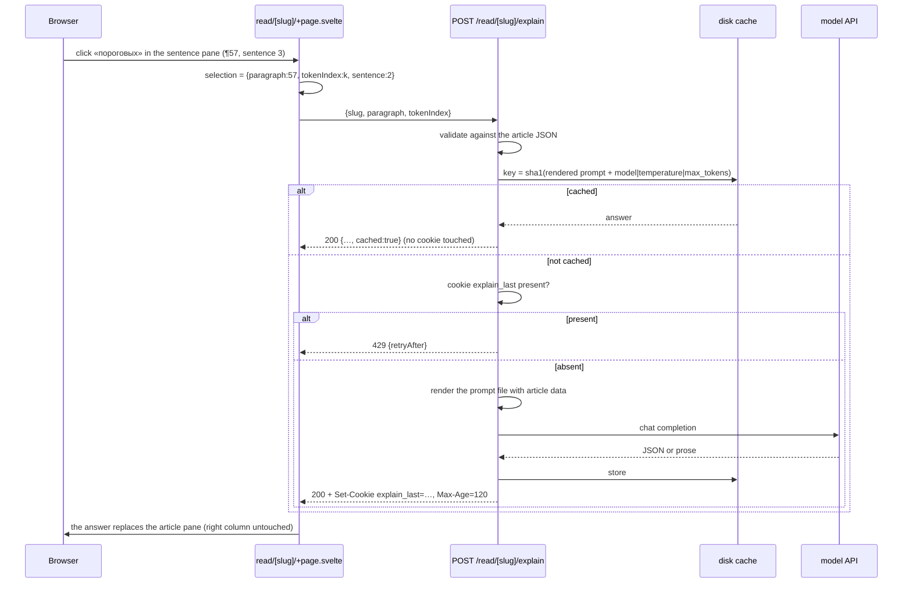

# Spec: объяснение слова — an explanation pane fed by a model

Status: draft — needs grilling (see Open questions); trigger and placement revised 2026-10-19
Date: 2026-10-19
Feature slug: `word-explanation`

## 1. What it does

Clicking a word in the Russian sentence of the **sentence pane** — the one holding the current RU/EN
pair — asks the server to explain that word in simple Russian, with etymology. The answer **takes over
the article pane** (the left column) until it is closed: scrollable, a × at its top right, and the same
key that already undoes things in this app. The click stays where it was, in the sentence pane, so the
word and the sentence it came from stay on screen while the answer replaces the text you were reading;
closing puts the article back where it was.

The article pane itself is **plain text**: no word in the article is clickable any more, and the
rare-word ranking that used to drive those buttons is now only data (kept in the JSON, still emitted by
the pipeline). The paragraph-translation pane and the sentence pane keep doing exactly what they do
today.

## 2. Decisions

| Decision | Why | Rejected |
| --- | --- | --- |
| **Server side**, one endpoint under the reader route | The model key must never reach the browser, and a limit the client can ignore is not a limit. The app is already SSR + `adapter-node` with no prerender, so a `+server.ts` costs nothing | Client-side call (key in the bundle); a proxy the user must run themselves |
| **One model call, no agent loop** | Explaining a word needs no second step in the model: the server decides what to fetch, fetches it once, and sends one prompt | A model-driven tool loop — the only source it could call is the one the server already fetches, for more latency and a second way to fail |
| **OpenRouter with `deepseek/deepseek-v4.1-flash`**, keyed by an app-specific `EXPLAIN_API_KEY` (user's call, 2026-10-19, Q8) | It is the only provider this machine has credentials for, it is OpenAI-compatible so the call is one `fetch`, and it is the model omp already runs here — measured at ~2 s and $0.00012–$0.00035 per call with reasoning disabled. The app reads its own variable and never touches omp's credential store | Reading `OPENROUTER_API_KEY` from the ambient environment (couples the app to a global name); a local model (no GPU and no server binary on this machine); an SDK |
| **Etymology: a Wiktionary lookup first, the model's memory only as a fallback** (user's call, 2026-10-19, Q5) | Measured: ru.wiktionary has a real etymology for 8/9 common words and a third of the rarest lemmas, and where it exists it is better than anything a model recalls (праслав. forms, etymon chains). The model is still needed to rewrite it for an A2 reader — dictionary prose is not A2 | Prompt-only (correct but thin, and unverifiable); an agent loop; a second source (en.wiktionary covers 2/10) |
| **The pane says where the etymology came from** — «по данным Викисловаря» or «сгенерировано, не проверено» | The reader can then weigh it. A rewrite of a sourced etymology and a recollection are not the same claim, and the difference is free to display | One disclaimer for both; no source line at all |
| **The open word wears the article's own "current" wash; Tab keeps the answer, dimmed** (user's call, 2026-10-19, Q6) | `--sentence` already means "the current one" here, and a clicked word is exactly that; `--accent-soft` keeps its existing meaning (hover, and the marked English runs). Tab then moves the selection without destroying what is being read — the dim, derived from "the selection no longer shows that word's sentence", is the cue that the left pane is not about the current pair | Accent-tinting the word (a second meaning for a colour that already means hover); tinting the sentence in the sentence pane (it holds one sentence); closing the answer on any selection change |
| **The pane opens when an answer arrives, not when the word is clicked** (user's call, 2026-10-19, Q11) | Measured: a cold click costs ~2.5 s (a Wiktionary GET plus one model call), a cache hit costs a file read. Swapping on arrival keeps every pre-answer failure — 429, 503, 5xx, timeout, missing key, prompt typo — next to the word with the article untouched, so §11's rule holds with no classify-then-un-swap path and no pre-flight knowledge of the deployment state. The deferred layout change is paid only on cold clicks | Swapping at click time and reporting 429/503/5xx inside the pane; a preflight request; un-swapping on rejection |
| **A second click replaces the answer in place** (user's call, 2026-10-19, Q12) | The pane is already the answer surface; demanding a close first turns a one-gesture lookup into two. The abort plus the monotonic request id already guarantee that a slow answer cannot overwrite a newer one, and the previous answer is kept (dimmed) rather than cleared, so a failed re-click never blanks the pane | Requiring a close first; a queue of answers; clearing the body on the click |
| **The pane shows the fetched Wiktionary text, not only the model's rewrite** (user's report, 2026-10-19, Q17) | The report that "the wiktionary entry is missing" was right in the way that matters: the fetch happened and the label was honest, but the reader saw only a paraphrase — and in the one case examined the paraphrase mangled the very detail the source had been fetched for (`*rъvātī` came back as `*гъvаtī`). Showing the cleaned text verbatim, plus a link to the page, makes the attribution checkable | Only a link to the page; only the label; storing the text in the cache record — it is already in the prompt, and the lookup runs before the cache read, so the response carries it either way |
| **Prompt in a file, read on every request** | The user asked to edit it. Reading per request (a ~2 KB file) means an edit takes effect on the next click with no restart and no rebuild | Prompt in code; prompt cached at boot |
| **The server re-derives everything from the article JSON** | The request carries `{slug, paragraph, tokenIndex}`; the word, lemma, grammar, sentence and translation come from `src/lib/content/<slug>.json`. The client cannot put arbitrary text into the prompt, and the endpoint is not a general Russian-word proxy | Client sends the word and sentence text |
| **Limit via a cookie, 2 minutes** | The user asked for it. `Max-Age=120` makes the cookie itself the window — no server-side clock, no storage | In-memory per-IP map (add it later if the endpoint is ever exposed) |
| **Cache hits bypass the limit** | A cached answer makes no external call, so there is nothing to throttle; throttling it would only make repeat clicks feel broken | Counting every click |
| **The cache is on disk, keyed by `sha1` of the request that produced it** (user's call, 2026-10-19, Q3) | A hash of the rendered prompt makes the prompt file self-versioning: edit one character and no stale answer can match, with no version counter to maintain. On disk, an answer survives a restart and is paid for once, ever | In-memory only (lost on restart); a `slug\|lemma\|sentence` key that cannot notice a prompt change; cache files committed as fixtures |
| **Model output rendered as text, never HTML** | No markdown renderer, no `{@html}`, no sanitizer needed. Three text fields with `white-space: pre-wrap` | Markdown rendering of the answer |
| **The answer is the lemma, in A2/B1 Russian, three fields, ~120 words** (user's call, 2026-10-19, Q4) | The dictionary form is what gets looked up again; the register is the one the reader can read without a dictionary; the example is what makes the word usable. Russian only — the official translation is one pane away | Explaining the inflected form alone; an English gloss line; letting the model pick its own length and register |
| **pymorphy3 tags go to the model raw, with a legend inside the prompt file** | pymorphy3 ships no Russian grammeme names (`lang.ru` holds only character and prefix tables), so decoding means owning a 40-entry table. A legend in the prompt file is editable, versioned by the hash, and costs ~60 tokens | A tag→Russian table in the server; hoping the model guesses the abbreviations |
| **`response_format: json_object`, three keys validated server-side, prose kept as a fallback** | The three fields are what the pane renders, and the fallback means a model that ignores the format still produces something readable (`parsed: false`) — no answer is ever thrown away | `json_schema` + `structured_outputs` (advertised for this model, unverified, unnecessary while the fallback exists); regex-parsing prose |
| **Article text is plain text; the word is picked in the sentence pane** | The user's call (2026-10-19): no more clickable rare words. The article reads as an article, and word-level interaction happens in the pane that already isolates one sentence — where every word is a candidate, not only the 200 rare ones | Word buttons in the article (the behaviour removed on 2026-10-19); clicking the whole sentence to mean "explain this sentence" |
| **Proper nouns are italic and not clickable** (user's call, 2026-10-19, Q2) | A name is not vocabulary: there is nothing to explain about «Германии» in a text about Germany, and italic marks it as a name at a glance. Every other token in the sentence pane stays a control | Clicking a name and getting a geography lesson; leaving names indistinguishable from words |
| **`proper` is a per-token flag computed in the pipeline** (rule B: first parse has a proper grammeme, or any parse does while the token is not sentence-initial; capitalised; len>1) | Capitalisation is what separates a name from a homograph, so the decision is per token and belongs next to the token offsets — the first change this feature makes to `build_article.py`. Measured on the live articles: 359 tokens in 66181, 233 in 24034, every one verified in context | A `proper` set in the Svelte component; calling pymorphy3 in the browser; reusing the pipeline's lemma-level `lemma_proper`, which marks a lemma rather than a token — one «Вера» (name) would italicise every «вера» (faith) in the article |
| **The answer takes over the article pane**, not a block in the right column | The user's call (2026-10-19, Q1). The article is long and read once; an answer is short and read closely, and it needs room — a 35 % block under the sentence pair holds a few lines and a scrollbar. The click stays in the sentence pane, so the word and its sentence remain visible while the article is replaced, and closing restores the article exactly | A third block under the sentence pair (the first draft); replacing the *sentence pair* (hides the word you clicked); a page-wide modal (loses the sentence you were reading) |
| **Closing is cheap and lossless** — × at the top right, Esc, article back at its scroll offset | The pane replaces the article, so the way back must be obvious and must not cost the reading position. Esc already means "undo the last thing" in this app; the same key closes the answer first | Making the user click a word again to get back; resetting the article to the top on close |
| **Missing configuration is a visible state, not a crash** | No key → the pane says so in Russian and the reader keeps working. A POC that dies on a missing env var is worse than one that says "не настроено" | Throwing at boot; hiding the feature silently |

## 3. Trigger and data flow

The trigger is a click on a word in the Russian line of the sentence pane. That pane already renders
the current sentence as a slice of `ru`; it renders it through the same `ruRuns` + `sentenceGroups`
machinery the article pane used to use, restricted to the current sentence, so every word carries its
exact character offsets and its `ruTokens` index. A click sets `selection.tokenIndex`, and the route
calls `explain(selection)`. Tab stepping and clicks on the sentence as a whole arrive with
`tokenIndex === null` and never request anything.



## 4. Server contract

`POST /read/[slug]/explain` (`src/routes/read/[slug]/explain/+server.ts`, JSON in, JSON out).

Request:

```json
{ "paragraph": 57, "tokenIndex": 12 }
```

Validation, in order — each failure is a 4xx with a Russian `message` the pane can show verbatim:

1. body parses as JSON and both fields are integers → else `400 bad-request`
2. `<slug>.json` exists (the same `import.meta.glob` the page uses) → else `404 not-found`
3. paragraph `i === paragraph` exists → else `400 bad-request`
4. `tokenIndex` in range of `ruTokens` → else `400 bad-request`
5. the word's sentence, derived server-side from `token.start` with the same rule the reader uses
   (`sentenceAt(token.start) ?? sentenceAt(max(start, end - 1))`), exists → else `400 bad-request`

There is no rarity requirement any more: the article carries no clickable rare words, so any word of
the paragraph may be asked about. `rare` only decides whether the frequency placeholders have values.

Prompt inputs, all from the article JSON: the token's `form` and `lemma`; when that lemma is in
`rare[]`, its `grammar` / `freq` (zipf) / `rank` / `forms`; the containing `ruSentences[i]` slice of
`ru`; the paired English sentence(s) via the same range rule as `enRangeFor`; and the article's
`title.ru` + `date`.

Response, 200:

```json
{
  "word": "пороговых",
  "lemma": "пороговый",
  "grammar": "ADJF,Qual plur,gent",
  "meaning": "…",
  "etymology": "…",
  "example": "…",
  "etymologySource": "wiktionary",
  "sourceText": "Происходит от гл. подрывать, из под- + рывать (рвать), далее от праслав. *rъvātī, …",
  "sourceUrl": "https://ru.wiktionary.org/wiki/%D0%BF%D0%BE%D0%B4%D1%80%D1%8B%D0%B2",
  "cached": false,
  "parsed": true,
  "retryAfter": 120,
  "elapsedMs": 1840
}
```

`grammar` is the clicked form's own tag string — the case, number and tense of the word actually in
front of the reader — and `null` when the form has none; the prompt's `{{grammar}}` falls back to the
rare entry's tag and then to «нет данных». It used to come from `rare[]` alone, which left most clicks
with «нет данных» in the chip *and* in the prompt (Q18).

`sourceText` is the cleaned Wiktionary text the answer was given — `null` when the lookup found
nothing, a stub included — and `sourceUrl` is the page it came from, derived from the API URL's origin
so offering the link never costs a second lookup. Both are computed on every request, cache hits
included, because the lookup runs before the cache is read (Q16).

`parsed: false` means the model answered prose instead of the requested JSON: the raw text is
returned in `meaning`, the other two fields are `null`, and the pane shows it as one block. That is
a rendering decision, never an error.

Validation of the JSON answer: `meaning` must be a non-empty string; `etymology` and `example` may be
absent and become `null`. Code fences are stripped before parsing, because models add them even when
told not to. Anything else — a preamble, a truncated object, prose — is `parsed: false` with the raw
text in `meaning`.

Errors: `{ "error": "<code>", "message": "<Russian, shown in the pane>", "retryAfter"?: <seconds> }`.

| Status | `error` | When | Pane shows |
| --- | --- | --- | --- |
| 400 | `bad-request` | malformed body, unknown paragraph/token, non-rare word | the message |
| 404 | `not-found` | unknown slug | the message |
| 429 | `rate-limited` | `explain_last` cookie present | «не чаще одного объяснения в 2 минуты» + countdown |
| 503 | `not-configured` | `EXPLAIN_BASE_URL` / `EXPLAIN_API_KEY` / `EXPLAIN_MODEL` missing | «объяснения не настроены» |
| 503 | `prompt-invalid` | prompt file missing, empty, or has unknown `{{placeholders}}` | the message, naming the file |
| 502 | `upstream-error` | non-2xx from the model, unreadable body | «сервис объяснений ответил ошибкой» |
| 504 | `timeout` | past `EXPLAIN_TIMEOUT_MS` | «сервис не ответил вовремя» |

One log line per request — slug, paragraph, lemma, `cached`, status, `elapsedMs`. The key is never
logged, never echoed in a response, and never sent to the client.

## 5. Rate limit: the cookie

| Property | Value |
| --- | --- |
| Name | `explain_last` |
| Value | unix milliseconds of the accepted request |
| `Max-Age` | 120 |
| `Path` | `/read` |
| `HttpOnly` | yes (the client has no business reading or forging it) |
| `SameSite` | `Lax` |
| `Secure` | yes when the request URL is https |

Rules:

- cookie **absent** → run the call, then set the cookie on the response
- cookie **present** → `429` with `Retry-After: ceil((value + 120000 − now) / 1000)`, cookie untouched
  (so a spam of clicks cannot extend the window)
- cookie **expires by itself** → the next request is accepted; no server-side state, no cleanup
- **cache hit** → neither checked nor set: the answer costs nothing, so it is not throttled
- the value is used only to compute `Retry-After` and to log; it is not a trust boundary

This is a courtesy throttle per browser, not a quota: clearing cookies, a second browser or curl
walks past it. Said out loud because pretending otherwise is worse than the limit.

## 6. Cache

The answer is cached **on disk**, keyed by the prompt that produced it:

- Key: `sha1(<the exact string sent to the model>)`, hex. The rendered prompt already contains the
  word, its lemma, the grammar, the sentence, the translation, the title and the date, so the hash
  covers the whole question — and it makes the prompt file self-versioning: edit one character of
  `prompts/word.md` and every cached answer stops matching, with no version bookkeeping anywhere.
- The hashed string also covers what is *not* in the prompt file: the model id, temperature and
  `max_tokens` are appended before hashing (`…\n--\n<model>|<temperature>|<max_tokens>`). The same
  prompt sent to a different model is a different answer, and switching models must not silently serve
  the old model's.
- Location: `EXPLAIN_CACHE_DIR`, default `.cache/explanations`, one file per answer, `<sha1>.json`.
  `.cache/` joins `.gitignore`: it is generated, and it is the only thing this feature writes.
- File contents: `{promptHash, createdAt, slug, paragraph, ruSentence, word, lemma, model,
  etymologySource, answer: {meaning, etymology, example}, raw}` — the raw model response is kept so a
  bad answer can be diagnosed without paying for the call twice. The 200 body is served from `answer`;
  `cached: true` is added on read. The fetched Wiktionary text is *not* stored separately: it is part
  of the hashed prompt, so a changed page invalidates the cached answer by itself.
- Read on every request; written after a successful model call, to `<sha1>.json.tmp` and then renamed,
  so a half-written file can never be read as an answer.
- No eviction: ~1 KB per answer, one file per (word, sentence, prompt) ever asked about. Deleting the
  directory is the eviction policy.
- The in-memory `Map` is gone — one `readFile` per click is cheaper than the bookkeeping, and a cache
  a restart throws away is not a disk cache. In-flight de-duplication stays: a second identical
  request while the first is running awaits the same promise instead of making a second call.
- A cache hit is checked **before** the cookie (§5) and never sets it (Q3).
- If the directory cannot be read or written, the request still succeeds: log it, serve the answer,
  skip the cache. A cache is an optimisation, not a dependency.

## 7. Prompt file

- Path: `EXPLAIN_PROMPT_PATH`, default `prompts/word.md`, resolved against `process.cwd()`.
- Read on every request. Empty file → `503 prompt-invalid`.
- Substitution is plain `{{name}}` → value, no templating language. Known names:

| Placeholder | Value |
| --- | --- |
| `{{word}}` | the clicked form, as it appears in the text |
| `{{lemma}}` | dictionary form |
| `{{grammar}}` | the clicked form's pymorphy3 tag string, verbatim — the rare entry's when the token carries none, «нет данных» otherwise |
| `{{forms}}` | the other forms of the lemma found in this article, comma-separated — «нет данных» as above |
| `{{sentence}}` | the Russian sentence the word sits in |
| `{{translation}}` | the official English translation paired with that sentence |
| `{{etymology_source}}` | the cleaned ru.wiktionary «Этимология» for the lemma, or «нет данных» (§7.1) |
| `{{title}}` | `title.ru` |
| `{{date}}` | the article date |
| `{{zipf}}`, `{{rank}}` | corpus frequency and its rank in this article's rare list — «нет данных» as above |

- Any other `{{…}}` in the file → `503 prompt-invalid` naming it. A typo in the prompt file must be
  loud, not a silently worse prompt.
- The file is the whole prompt: the server sends it as a single `user` message. No system message is
  prepended, so the user keeps full control of the instructions.

### Etymology lookup

Before the model is called, the server tries to find a real etymology: a model recalling one from
memory is the weakest part of this feature, and ru.wiktionary has something for about a third of the
rarest lemmas and most common words.

- `GET {EXPLAIN_WIKTIONARY_URL}?action=parse&page=<lemma>&prop=text&format=json&formatversion=2&redirects=1`
  with an identifying `User-Agent` (`EXPLAIN_USER_AGENT`) — Wikimedia answers 403 to anonymous fetches.
- Only the `Этимология` section is taken; it ends at the next heading. Tags and the inline CSS
  Wikimedia embeds are stripped, the heading is dropped, whitespace collapsed, and the result capped at
  1200 characters.
- Stubs count as absent: «Происходит от ??», «От ??», «Происходит от», or anything under 80 characters
  after cleaning. They are the majority — 22 of the 30 rarest lemmas in 66181, 18 of 30 in 24034.
- Any failure — timeout (`EXPLAIN_WIKTIONARY_TIMEOUT_MS`, default 4000), non-200, unparsable page —
  means «нет данных» and the prompt-only branch runs. The lookup never fails the request.
- No lookup cache of its own: the fetched text is part of the rendered prompt, so the answer cache's
  hash covers it, and the cookie already limits a miss to one fetch per 2 minutes.
- **Consequence, found while implementing (Q16)**: because the hash *is* the rendered prompt and the
  etymology is inside it, the lookup runs before the cache check — so a cache hit still costs one
  Wiktionary GET (measured ~0.4 s), and a Wiktionary outage changes the rendered prompt, which misses
  the cache and buys a fresh model call for a word already answered. The cookie no longer bounds those
  fetches either, since a cache hit never consults it.
- Coverage measured 2026-10-19 on the rendered pages: 2/30 among the 30 rarest lemmas of 66181, 10/30 in
  24034, 8/9 among common words. en.wiktionary does not earn a second request (2/10).
- The fetched text is returned in the 200 as `sourceText` and shown in the pane verbatim (Q17), with
  `sourceUrl` as a link, so the reader can check the paraphrase against the source it credits.
- The **lemma** is looked up, not the clicked form: «пороговых» → «пороговый», a stub, while «порог» is
  rich. A base-word fallback would be a real improvement; it is a non-goal for now, and this is where it
  would go.
- Licensing: Wiktionary text is CC BY-SA. Fine for a personal POC with the «по данным Викисловаря»
  line; a public deployment needs a real attribution decision.

- Initial content of `prompts/word.md` (to be edited, this is the draft to grill):

```text
Ты объясняешь одно русское слово человеку, который учит русский язык и читает тексты Кремля.

Слово в тексте: {{word}}
Словарная форма: {{lemma}}
Грамматика: {{grammar}} — теги pymorphy3 (OpenCorpora), через запятую и пробел. Расшифровка:
  часть речи — NOUN, ADJF (полное прилагательное), ADJS (краткое), VERB, INFN, PRTF (причастие),
  GRND (деепричастие), ADVB (наречие), NUMR, NPRO, PREP, CONJ, PRCL, INTJ;
  род — masc/femn/neut, число — sing/plur, падеж — nomn/gent/datv/accs/ablt/loct,
  время — past/pres/futr, вид — perf/impf, наклонение — indc/impr, одушевлённость — anim/inan.
Другие формы этого слова в тексте: {{forms}}
Предложение: {{sentence}}
Официальный английский перевод этого предложения: {{translation}}
Источник: {{title}}, {{date}}
Этимология из Викисловаря: {{etymology_source}}

Отвечай на простом русском языке — так, как объясняют иностранцу, который читает со словарём.
Никакого канцелярита, никаких англицизмов, никаких сокращений вроде «т.е.».
Уровень — A2–B1: короткие предложения, самые частые слова.
Весь ответ — по-русски: не переводи слово на английский и не давай английских пояснений.

Что нужно:
1. Значение — что слово значит именно здесь, в этом предложении. Если слово многозначное, назови
   значение, которое работает в этом предложении, и одной фразой — остальные.
2. Этимология — откуда слово пришло: исконное или заимствованное, из какого языка и когда, через
   что прошло, какие родственные слова есть в русском.
   Если выше есть этимология из Викисловаря (не «нет данных») — перескажи её простыми словами и
   ничего не добавляй от себя. Если её нет — отвечай по своим знаниям, но если не уверен, скажи
   «точных данных нет». Не выдумывай этимологию: лучше «точных данных нет», чем красивая догадка.
3. Пример — одно короткое своё предложение с этим словом. Не бери предложение из текста.

Требования:
- Если {{word}} — форма, назови начальную форму и скажи, как она образована.
- Не пересказывай предложение целиком и не переводи его — объясняй слово.
- Всего не больше 120 слов.
- Ответ — только JSON, без пояснений вокруг:
  {"meaning": "…", "etymology": "…", "example": "…"}
```

## 8. Provider configuration

Read through `$env/dynamic/private` (runtime, so a key can be added to `.env` without a rebuild —
`$env/static/private` would bake it in). No SDK, no new dependency: `fetch` against an
OpenAI-compatible `POST {EXPLAIN_BASE_URL}/chat/completions`.

Facts measured on this workstation (2026-10-19), before any provider was chosen:

- Every endpoint tested answered at the TLS layer from here: `api.openai.com`, `openrouter.ai`,
  `api.anthropic.com`, `generativelanguage.googleapis.com`, `api.mistral.ai`, `api.deepseek.com`,
  `api.groq.com` (401/403 without a key; the two that serve unauthenticated listings returned 200 with
  a body). The kremlin.ru timeout is a host-specific block, not an egress restriction, so a
  server-side call to one of these works from this machine. This was a reachability check, not a
  latency one — no timings were measured.
- Local inference is not available: no GPU (`/proc/driver/nvidia` absent), no `ollama` /
  `llama-server` / `vllm` binary, nothing listening on 11434 / 8080 / 8000 / 1234, 8 cores, ~15 GiB
  RAM. The provider must be remote, which is what this design assumes.
- Credentials on this machine: an OpenRouter key in `OPENROUTER_API_KEY` (also in `~/.secrets`, which
  `.bashrc` / `.zshrc` source) and a second, different OpenRouter key in omp's own store
  (`~/.omp/agent/agent.db`). No `OPENAI_API_KEY`, `ANTHROPIC_API_KEY`, `GEMINI_API_KEY`,
  `DEEPSEEK_API_KEY`, `GROQ_API_KEY` or `MISTRAL_API_KEY` is set. omp's default model is
  `openrouter/deepseek/deepseek-v4.1-flash` (`~/.omp/agent/config.yml`). The app reads its own
  `EXPLAIN_API_KEY` and never touches omp's credential store.
- `.env` is loaded by Vite in development only. `node build/index.js` does **not** read it, so a
  production run needs the variables in the process environment (`node --env-file=.env build/index.js`).
- The provider and the model id are decided (Q8, §2): OpenRouter with `deepseek/deepseek-v4.1-flash`.
  The measurements above are why.

| Variable | Default | Meaning |
| --- | --- | --- |
| `EXPLAIN_BASE_URL` | — (required) | e.g. `https://openrouter.ai/api/v1` |
| `EXPLAIN_API_KEY` | — (required) | bearer token |
| `EXPLAIN_MODEL` | — (required) | model id sent as `model` |
| `EXPLAIN_PROMPT_PATH` | `prompts/word.md` | prompt file |
| `EXPLAIN_TIMEOUT_MS` | `20000` | abort → 504 |
| `EXPLAIN_MAX_TOKENS` | `400` | the answer is capped at ~120 words by the prompt |
| `EXPLAIN_TEMPERATURE` | `0.3` | etymology should be boring, not creative |
| `EXPLAIN_CACHE_DIR` | `.cache/explanations` | one `<sha1>.json` per answer; `.gitignore`d |
| `EXPLAIN_WIKTIONARY_URL` | `https://ru.wiktionary.org/w/api.php` | the etymology lookup; empty or `off` disables it |
| `EXPLAIN_WIKTIONARY_TIMEOUT_MS` | `4000` | a slow dictionary must not eat the model's timeout |
| `EXPLAIN_USER_AGENT` | `ru-reader/0.1 (personal reading tool)` | Wikimedia 403s anonymous fetches; put a real contact here |

Request body sent upstream: `{ model, temperature, max_tokens, response_format: {type:'json_object'}, reasoning: {enabled: false}, messages: [{role:'user', content: <rendered prompt>}] }`.

`reasoning: {enabled: false}` is not decoration. Measured 2026-10-19 against `deepseek/deepseek-v4.1-flash`
with the real prompt: the default configuration spent **384–400 of the 400-token budget on reasoning
tokens** — `finish_reason: length`, the JSON truncated mid-string, and one of three calls returned
`content: null` (the whole budget went to thinking, nothing to the answer). With `reasoning:
{enabled: false}` — or `{effort: 'none'}`, or `reasoning_effort: 'none'`, all three verified — the same
prompts returned valid JSON in ~2 s. Measured cost per call, reasoning off: **$0.00012–$0.00035**, not
the $0.00004 the published per-token price implies.
`.env` and `.cache/` are **not** ignored by the current `.gitignore` — the implementation adds both in
the same change; a `.env.example` with the three required names and no values is committed.

Privacy, stated because it is real: the sentence, its translation and the word are sent to a
third-party model. The texts are public kremlin.ru material, so this is acceptable — but it is a
consequence, not an accident.

## 9. Client behaviour

- New component `ExplanationPane.svelte`, pure display: `{selection, explanation}` in, plus an `onclose`
  callback out — the × is the only control it owns.
- State in `read/[slug]/+page.svelte`: `{status: 'idle'|'loading'|'ready'|'error', request, word, lemma, grammar, meaning, etymology, example, parsed, message, retryUntil}`.
- `explain(sel)` is called from the `onSelect` handler (an event, not an `$effect`) when
  `sel.tokenIndex !== null`; it does nothing if the `(slug, paragraph, tokenIndex)` triple is the one
  already on screen.
- One `AbortController` and a monotonic request id: a new click aborts the old fetch, and a response
  whose id is not the latest is dropped — a slow answer can never overwrite a newer one.
- **A second click replaces the answer in place** (Q12), and the previous answer is never cleared. It
  stays on screen, already dimmed by the staleness rule (the selection has moved to the new word's
  sentence), with a «спрашиваю «B»…» line above it; the pane's header keeps naming the answer that is
  on screen. When B's answer arrives, header, body and word wash switch together. If it fails, the
  previous answer stays with B's error above it. Clicking the word whose answer is already displayed, or
  whose request is still in flight, does nothing.
- **The pane swap.** `section.pane-ru` renders `ExplanationPane` instead of `RussianPane` while an
  explanation is open, so article and answer are never both on screen. The pane's `scrollTop` is read
  before the swap and written back after the article is mounted again: hiding a scroll container
  resets its scroll position, so the offset is restored explicitly rather than assumed.
- The article pane's own centring must not fight that restore: `RussianPane` skips the centring effect's
  first run in every mount and centres only when the selection actually changes, so the offset the page
  writes back after a close stands (measured: `scrollTop` identical before the word click and after
  Esc; before the guard it drifted ~93 px as the smooth centring won the race).
- **The swap is triggered by the answer, not by the click** (Q11): `section.pane-ru` keeps rendering
  `RussianPane` while the request is in flight and after any failure, and renders `ExplanationPane`
  only once a response carrying an answer has arrived — which on a cache hit is milliseconds. The word
  line is rendered from the local `ruTokens` entry, so it is available immediately, but it waits for
  the pane it belongs to.
- While `status === 'loading'`, the sentence pane shows «спрашиваю…» next to the clicked word and the
  article is untouched. If the answer arrives after the selection has moved on, the pane still opens,
  and it opens dimmed (§9's staleness rule) with its header naming the word.
- **Focus.** Opening moves focus to the explanation region (`tabindex="-1"`), so Esc works from
  anywhere and a screen reader reads the answer; closing returns focus to the word that was clicked.
- **Esc is layered** (Q9a, user's call, 2026-10-19): with an explanation open it closes that; with none
  open it clears the selection, as it does today; with neither, the key is left to the browser rather
  than swallowed. One key, the most recent thing first — the convention dialogs use. No second key.
- Cooldown: `retryAfter` from a 200 or a 429 sets a local deadline, but the client does **not** gate on
  it — a click always sends the request, because a word asked about before is served from the cache
  without touching the window (Q3). The deadline drives the countdown line only, in whole seconds,
  updated once a second. Gating locally would make cache hits impossible.
- **A refusal never takes the pane**, and with the swap on arrival it cannot: the pane is not rendered
  until there is an answer. While the article is showing, a 429, a 503 or a 5xx leaves the article
  alone and puts the message in the sentence pane, next to the word that was clicked — replacing the
  text you are reading with «подождите 2 минуты» is worse than not answering. When the pane is already
  open (a re-click), a failed re-click keeps the last answer, dimmed, with the message above it.
- Selection changes without a word (Tab, plain-text click) leave the explanation open, dimmed — it
  belongs to a word, not to the current sentence.
- Accessibility: the explanation region is `aria-live="polite"` with `lang="ru"`, so arriving text is
  announced. Enter/Space on a focused word button already triggers the click path, so the keyboard
  route works.
- The explanation is fetched with the default `credentials: 'same-origin'`, which sends the cookie.
- The source line under the etymology reads «по данным Викисловаря» when `etymologySource` is
  `wiktionary`, and «сгенерировано, не проверено» otherwise. It is hidden entirely when `parsed` is
  false — there is no etymology field to attribute.
- The source block sits at the end of the pane at full contrast: the attribution line, a collapsed
  `<details>` «Текст из Викисловаря» holding `sourceText`, and a link to `sourceUrl` naming the lemma
  (Q17). The model's prose dims; the attribution and the way to check it do not.
- The open word carries the article's own "current" wash: `background: var(--sentence)`, hover
  `--accent-soft`, `border-radius: 2px`, `aria-current="true"`, and the browser's focus ring left
  alone. The tint exists only while the sentence pane still shows that word's sentence — after Tab the
  word is rendered nowhere, and the pane header is the only thread back to it.
- The sentence in the sentence pane gets no tint of its own: the pane holds one sentence, so a tint
  would say nothing, and the sentence-level tint belongs to the article, which the answer is covering.
- Staleness is derived, never stored, and it is a **sentence** comparison: the explanation pane owns
  `openWord = {paragraph, sentence, tokenIndex}`; stale means the current selection is not that
  sentence. Tab clears `Selection.tokenIndex`, so comparing `tokenIndex` would go stale on the first Tab
  and never come back; comparing the sentence makes Tab away dim the body and Tab back restore it — and
  the word's wash returns with it, because `SentencePane` tints the button whose index equals
  `openWord.tokenIndex` whenever the selection shows that sentence. While stale the answer **body**
  dims to `0.55`; the header, the source line and the × keep full contrast, because a dimmed close
  button reads as disabled.

## 10. Layout

```text
┌─ Объяснение слова ────────────────┬─ English translation ──────────────────────┐
│ пороговых → пороговый  [ADJF]  ×  │ перевод абзаца, пара предложений подсвечена │ ← .en-para
│                                   ├────────────────────────────────────────────┤
│ Значение …                        │ RU: … пороговых … — клик по слову          │ ← .en-sentence
│ Этимология …                      │ EN: …                                      │
│ Пример …                          │                                            │
│ сгенерировано, не проверено       │                                            │
└───────────────────────────────────┴────────────────────────────────────────────┘
  ↑ section.pane-ru while an explanation is open; the article comes back on close
```

- `section.pane-ru` is the swap point: `<RussianPane>` normally, `<ExplanationPane>` while an
  explanation is open. The pane keeps its `overflow-y: auto`, so the answer scrolls in the same
  container the article did; the × lives in a header row that is `position: sticky; top: 0` inside
  that container — a close button that scrolls out of view is not a close button.
- The explanation is prose: give it its own measure (~46rem, the cap the home route's `main` uses)
  rather than the pane's full width. The article pane has no cap of its own today; leave it alone.
- The Russian line of the sentence pane renders through `ruRuns` + `sentenceGroups` limited to the
  current sentence, so every word is a control carrying its exact offsets and its `ruTokens` index.
  Word-level controls live there and only there; the article pane keeps one handler, on the sentence.
- Proper nouns render italic (`class="proper"`) and are **not** controls; every other token is a
  button. The rule lives in the pipeline (§2, rule B) and arrives as `ruTokens[].proper`, so the
  components do no morphology: `ruRuns` carries the flag into both panes, and the article pane applies
  the same class with no handler attached.
- The word line shows the clicked form and the lemma, and dims when the current selection no longer
  pins that word.
- The header's grammar chip shows the clicked form's tag and is **not rendered** when there is none
  (Q18): a chip reading «нет данных» tells the reader nothing and costs a line of the header.
- The chip explains itself on hover and on focus (Q19): a `role="tooltip"` popup 6 px under the chip,
  one row per tag component — the code in a monospace column, what it means in the other. The rows come
  from `src/lib/grammar.ts`, which carries the dictionary's own `grammemes.json` (name → Russian name)
  minus its category nodes, so any tag a future article produces is explainable; `UNKN` is special-cased
  because it is not a grammeme but pymorphy3's answer for a form it does not know. The popup is
  `position: fixed` — the pane is a scroll container and would clip an absolute one — placed from the
  chip's box and re-placed on window scroll and resize. The chip is a `button` so the keyboard can reach
  it, which is also how a tap opens the popup on a touch screen.
- The popup is not interactive, so dismissal needs no grace period: it goes when the pointer leaves the
  chip, on blur, when a new answer arrives (the tag it explained is gone), and on Escape — which is why
  the popup is the **first** layer of the page's Escape stack, above the answer (Q19).
- The word controls are `button.tok`: `--sentence` wash while one is the open word, `--accent-soft` on
  hover, `border-radius: 2px`, and no custom focus style — the default ring is what the article's
  sentence buttons already use.
- Narrow screens (≤ 899 px) — **not implemented, Q10**: the reader stacks and the article pane
  sits *below* the sticky 60vh right column, so a swap in place would put the answer off-screen under
  the column the click came from. The proposal on the table is a fixed overlay covering the viewport,
  own scroll, `z-index: 3`, same × and Esc, article left mounted underneath so the page scroll needs no
  save or restore at this width. Measure at 400 px and 900 px rather than assuming.

## 11. Failure modes

| Cause | What the user sees |
| --- | --- |
| no key configured | «Объяснения не настроены: нет EXPLAIN_API_KEY» next to the word in the sentence pane; the article is untouched |
| prompt file missing / typo'd placeholder | «Промпт не найден: prompts/word.md» / «Неизвестные подстановки: {{lemma2}}» — same place |
| second click inside 2 minutes | cooldown line + countdown next to the word; the request is still sent (Q3), so a word already in the cache is answered instead of refused |
| model returns prose, not JSON | the prose as the answer body, `parsed: false` — no error state. It is an answer, so it opens the pane |
| model API down / 5xx | «Сервис объяснений ответил ошибкой (502)» next to the word; if the pane is already open, the last answer stays, dimmed, with the message above it |
| slow model | «спрашиваю…» next to the word, then the timeout line in the same place: a request that never produces an answer never hides the article |
| click a word, then Tab away | the explanation stays open, dimmed, marked as belonging to another word |
| cache directory unreadable or read-only | nothing visible: the answer is still served, the entry is skipped, one log line |
| the model spends the budget on reasoning | `finish_reason: length` or `content: null` → 502 `upstream-error`, never rendered as an answer. Prevented in the request (§8), caught here anyway |
| Wiktionary unreachable, slow, or a stub | nothing visible: the answer is prompt-only and the source line says «сгенерировано, не проверено» |

The line between the two halves of that table is the answer's arrival (Q11): anything that fails before
an answer exists leaves the article alone and reports itself in the sentence pane, where the click was.
Because the pane opens only on arrival, that is *every* pre-answer failure without exception — no
classification, no un-swap, no pre-flight knowledge of the deployment state. Once an answer is on
screen, a later failure reports in the pane above the previous answer. Replacing the article with an
error message would punish the reader for a server-side problem.

## 12. Verification

Server, against a local stub provider (no key, no cost, deterministic):

1. `EXPLAIN_BASE_URL=http://127.0.0.1:<port>/v1 EXPLAIN_API_KEY=x EXPLAIN_MODEL=stub
   EXPLAIN_CACHE_DIR=.cache/test` — the stub returns a fixed JSON answer and echoes the request it
   received.
2. POST `{paragraph:57, tokenIndex:<пороговых>}` → 200, `Set-Cookie: explain_last=…; Max-Age=120;
   HttpOnly; Path=/read`, `cached:false`; the stub's received prompt contains the word, the lemma,
   the sentence and the translation from the JSON — asserted, not eyeballed.
3. The answer is on disk: one `<sha1>.json` in `EXPLAIN_CACHE_DIR`, its `promptHash` equal to the
   `sha1` of the string the stub received plus the model line, and its `word` / `slug` / `paragraph`
   matching the request.
4. Immediate second POST, same cookie, same word → 200 `cached:true`, no cookie set, and the stub
   received **no** second request — the cache is consulted before the window.
5. Same cookie, a *different* word → 429 + `Retry-After` ≤ 120, and the stub received no request.
6. Restart the server and repeat step 4 → still `cached:true`, no model call. The disk cache survives.
7. Append a space to `prompts/word.md` → the word from step 2 makes a new call (`cached:false`) and a
   second file appears; revert the edit → the first file is used again, no call.
8. Change `EXPLAIN_MODEL` → a new call, `cached:false` (the model is part of the hash).
9. Delete `EXPLAIN_CACHE_DIR` → the next click calls the model again. Make it read-only → the click
   still succeeds with `cached:false`, no error.
10. Add `{{nope}}` to the prompt → 503 `prompt-invalid` naming it; unset `EXPLAIN_API_KEY` → 503
    `not-configured`.
11. `{paragraph: 999}` and an out-of-range `tokenIndex` → 400; a word absent from `rare[]` → 200 (the
    rarity requirement is gone); unknown slug → 404.

Etymology lookup, against a local stub of the Wiktionary API (`EXPLAIN_WIKTIONARY_URL=http://127.0.0.1:<port>/w/api.php`):

- The stub serves a page whose `Этимология` section has real text → the prompt the stub *model* receives
  contains that text, and the answer comes back with `etymologySource: "wiktionary"`.
- The stub serves «Происходит от ??» → treated as absent: `etymologySource: "model"` and «нет данных»
  in the prompt.
- The stub returns 500, hangs past `EXPLAIN_WIKTIONARY_TIMEOUT_MS`, or the page has no etymology
  section → same as absent, nothing surfaces to the reader, the model is still called.
- One fixture taken by hand from the real API goes through the cleaner: the inline CSS and the following
  «Фразеологизмы» heading must not survive into the prompt.

Real provider — already run once, 2026-10-19, against `deepseek/deepseek-v4.1-flash` (≈ $0.001 total):

- Four calls with the real draft prompt and real article data (`накарябал`, `транзитерами`,
  `транспарентно`, `пороговых`). Results: `response_format: json_object` is accepted, the three keys
  come back, the register is A2/B1 and Russian-only, and the initial form is named as asked.
- The default configuration is unusable: 384–400 of 400 completion tokens were reasoning tokens,
  `finish_reason: length`, truncated JSON, and one call returned `content: null`. With `reasoning:
  {enabled: false}` (and equally with `{effort:'none'}` / `reasoning_effort:'none'`): `reasoning_tokens`
  0, `finish_reason: stop`, valid JSON, ~2 s, $0.00012–$0.00035 per call.
- Keep one such call in the loop when the model id or the provider changes; a stub cannot see any of
  this.

Browser (real Chromium, as the reader is verified today):

12. Click «пороговых» in the Russian line of the sentence pane (¶57, sentence 3) → `section.pane-ru`
    now shows the explanation with the stub's text and a × at its top right; the paragraph pane and
    the sentence pane are byte-identical to before the click, so the word and its sentence are still
    on screen; the live region announces the answer.
13. Before that click, scroll the article to ¶100. Close with Esc → the article is back, `scrollTop`
    equals the pre-click value (±1 px), the same sentence is selected, and focus is on the clicked
    word.
14. Close with the × instead → the same restore. With no explanation open, Esc still clears the
    selection, as it does today (layered Esc).
15. With the explanation open, click another word in the sentence pane → the pane's content is
    replaced in place, with exactly one POST.
16. Click «энергоносителей» immediately → the cooldown line appears next to the word, the pane does
    **not** take over, no second request; wait out the window (or clear the cookie) → it works.
17. Click a word already in the disk cache inside the window → it answers instantly, `cached:true`, no
    429 — the bypass is visible, not just documented.
18. Tab stepping through sentences never sends a request (assert zero POSTs while stepping); the
    explanation stays open and dims.
19. Layout measured at 1400 px, 900 px and 400 px: the explanation's measure caps at ~46rem, at 400 px
    the explanation covers the viewport with its × reachable without scrolling, and the sticky column
    never overflows 60vh. With the article showing, the first pane has no `button` and clicking
    anywhere in it sends no request.
20. `grep -r EXPLAIN_API_KEY build/client` after `bun run build` → no match; `bun run check` clean;
    the reader's own regression checks still pass: 135 paragraph texts byte-identical to the JSON, no
    `button` inside `article`, and the rare data still in the JSON (264 tokens flagged in 24034, 233
    in 66181).
21. After regenerating both articles: paragraph texts still byte-identical to the committed JSON, the
    `pairs` alignment unchanged, and `proper: true` on 359 tokens in 66181 (168 distinct forms) and 233
    in 24034 (86). Verified 2026-10-19: 0 differences in `ru`/`en`/`pairs`/`ruSentences`/
    `enSentences`/`rare` and in every token's `start`/`end`/`form`/`lemma`/`rare`; dropping the new key
    reproduces the previous files byte-for-byte. **16 tokens in 66181 are both `rare` and `proper`** (0
    in 24034): the tokens whose proper reading exists only in a non-first parse, so their lemma evades
    the first-parse-based `lemma_proper` and stays eligible for `rare`. The overlap is unavoidable under
    rule B — exactly 368 tokens satisfy the rule's conditions in 66181, so forcing disjointness would
    cap `proper` at 352, below the 359 the rule yields. Recorded rather than papered over: rarity is
    data, and the flag only decides whether a token is a control.
22. Click a word → it carries the article's own wash and `aria-current`; Tab to the next sentence → the
    answer stays, its body at ~0.55 opacity, the × at full contrast; Shift+Tab back → full contrast
    again. Assert the computed styles, not the presence of a class.
23. **Ran 2026-10-19** against `vite dev` on 5199 with the real key. A cold click on «пороговых»
    (24034 ¶57) opened the pane only when the answer arrived, 4438 ms server-side, with «спрашиваю…»
    next to the word while it was in flight; the same word again came from the disk cache in 465 ms; an
    uncached word inside the window left the article in place and showed «Не чаще одного объяснения в 2
    минуты» with a ticking «ещё 114 с» next to the word it was clicked on; Tab dimmed the answer body to
    0.55 with the × at 1 and Shift+Tab restored both the body and the word's wash; Esc returned the
    article to the exact `scrollTop` it had before the click and put focus back on the word button; a
    deliberately typo'd placeholder answered `503` «Неизвестные подстановки: {{nope}}» next to the word
    with the article untouched, which also proves the prompt file is read per request. `bun run check`
    290 files / 0 errors / 0 warnings, `bun run build` clean, `grep -r EXPLAIN_API_KEY build/client`
    0 files, and both articles still render 373/373 and 556/556 sentences byte-identical to their JSON
    with 0 `button` elements in the article pane.

24. **Ran 2026-10-19**, after the report that the entry was missing: clicking «подрыву» (66181 ¶2)
    answered from the cache in 659 ms, and the pane showed, under «по данным Викисловаря», a collapsed
    «Текст из Викисловаря» holding 763 characters starting «Происходит от гл. подрывать, из под- +
    рывать (рвать), далее от праслав. *rъvātī…» — the reconstruction the model had rendered as
    «*гъvаtī» — plus a link to `https://ru.wiktionary.org/wiki/подрыв`.

25. **Ran 2026-10-19**, after the report that the header said «нет данных»: every token in both
    regenerated articles carries its own tag (5238/5238 in 66181, 7254/7254 in 24034) with 0 differences
    in `ru`/`en`/`pairs`/`sentences`/`rare`/`stats` and in every pre-existing token field. The pane
    header for «распорядилась» now reads `VERB,perf,intr femn,sing,past,indc` and for «подрыву»
    `NOUN,inan,masc sing,datv` — the clicked form's, not the lemma's.

26. **Ran 2026-10-19**, after the request that the chip explain itself: hovering the chip on
    «распорядилась» (`VERB,perf,intr femn,sing,past,indc`) put a 7-row popup 6 px under it, 226×158 px,
    inside the viewport and over the answer text — the pane's `overflow-y: auto` did not clip it. Moving
    the pointer away left 0 popups; `focus` on the chip brought it back; the first Escape closed the
    popup and left the answer (1 `.explain`, 0 popups), the second closed the answer and returned the
    article (373 sentences). At 800×900 the popup's right edge sat at 522 px and it stayed 6 px under the
    chip across a 320 px window scroll.

## 13. Non-goals

- No gloss of the *word* on hover, no word-level English alignment: the grammar chip's popup explains
  the codes (Q19), not the word, and outside the sentence pane the words stay plain text.
- No clickable words in the article text — removed 2026-10-19. The rare ranking stays in the JSON as
  data; nothing in the first pane is a control except the sentence itself.
- No streaming (the answer is ~120 words; a spinner is enough), no per-user accounts or quotas, no
  multi-provider abstraction. The disk cache is not a history: it is keyed by prompt hash, nothing in
  the UI lists it, and no prompt-version counter exists because the hash is the version.
- No change to the generated article JSON or to the pipeline beyond the per-token `proper` flag (§10).
- No second dictionary, no base-word fallback when the lemma's page is a stub (§7.1), no lookup cache of
  its own, no etymology editing UI.

## 14. Open questions

Numbering follows the grilling rounds. **Q1 and Q2 are answered** — see §2 — and stay here only as
pointers.

- **Q2 — answered**: every token in the sentence pane is clickable *except proper nouns*, which render
  italic in both panes and are not controls. Rule B and the per-token flag are in §2 and §10.
- **Q3 — answered**: a cached answer bypasses the 2-minute cookie window, and the cache is on disk
  keyed by the `sha1` of the request (§2, §6). Open: whether the hash covers the model and sampling
  parameters as well as the prompt (Q15).
- **Q4 — answered**: the lemma (named next to the clicked form), raw pymorphy3 tags with a legend in
  the prompt file, a fresh example sentence, A2/B1 Russian and nothing but Russian, ~120 words with
  `max_tokens` 400, `response_format: json_object` with a prose fallback. See §2, §4, §7.
- **Q5 — answered**: a ru.wiktionary lookup first (server-side, one fetch, before the single model
  call), the model's memory only when the page is absent or a stub, and the pane says which of the two
  the reader got. Not an agent loop. See §2, §7.1.
- **Q6 — answered**: the open word wears the article's `--sentence` wash (`--accent-soft` stays hover),
  the sentence pane's own sentence gets no tint, and Tab keeps the answer with its body dimmed to 0.55
  while the header, the source line and the × stay at full contrast. See §2, §9.
- **Q7 — deferred** (user's call, 2026-10-19): the ADR offer is set aside, not decided. Nothing in the
  implementation depends on it.
- **Q8 — answered**: OpenRouter (`https://openrouter.ai/api/v1`) with `deepseek/deepseek-v4.1-flash`,
  keyed by an app-specific `EXPLAIN_API_KEY` — the only provider this machine has credentials for, and
  the model omp already runs. See §2, §8.
- **Q9 — answered** (user's call, 2026-10-19, "as written"): (a) Esc is layered — it closes the answer
  first, then clears the selection, and with neither it is left to the browser; no second key. (b) the
  first Esc keeps the selection; a second clears it. (c) the article's `scrollTop` is saved once, at the
  swap, and written back when `RussianPane` remounts — never re-saved by a later click, whose pane holds
  the answer's scroll. (d) opening moves focus into the region and closing returns it to the word. §9
  carried all four as written; nothing changed in the fold.
- **Q10 — desktop only, for now** (user's call, 2026-10-19, "ship the desktop path"): no narrow-screen
  overlay is built, so at ≤ 899 px the answer renders in the article pane, below the sticky right
  column, where it is off-screen at the moment of the click. A known gap, not an oversight; §10's
  overlay paragraph is the proposal for closing it. Facts already measured, for whenever it is picked
  up: at
  ≤ 899 px `.reader` is a flex column with `height: auto`, `.pane-en` is `order: -1; position: sticky;
  top: 0; max-height: 60vh; z-index: 2`, and `.pane-ru` is `overflow-y: visible`, so the page scrolls
  and the pane does not; the sticky column's height is content-dependent (`.en-para` flex 1,
  `.en-sentence` ≤ 45%), so "cover everything below it" is not writable as a CSS constant.
- **Q11 — answered**: the pane opens when an answer arrives, never on the click. «спрашиваю…» and every
  pre-answer failure — 429, 503, 5xx, timeout, missing key, prompt typo — appear next to the word with
  the article untouched; a refusal therefore cannot take the pane. An answer that lands after the
  selection moved on still opens the pane, dimmed. See §2, §9, §11.
- **Q12 — answered**: a second click replaces the answer in place; the previous answer is kept, dimmed,
  under a «спрашиваю…» line until the new one arrives, and stays with the new word's error if it fails.
  The header follows the answer on screen, not the pending click. See §2, §9.
- **Q15 — answered**: the cache hash covers `model|temperature|max_tokens` appended to the rendered
  prompt, because the same prompt sent to a different model is a different answer. The user asked for
  "the sha1 of the used prompt"; the extra fields are a superset and one line to drop. See §6.
- **Q18 — answered** (user's report, 2026-10-19): the pipeline writes every token's own pymorphy3 tag
  and the prompt and the header use it, falling back to the rare entry's and then to «нет данных»; the
  header renders no chip when there is no tag. See §4, §7, §9.
- **Q19 — answered** (user's request, 2026-10-19): the terse chip pops up a per-component gloss of its
  tag on hover and on focus, and dismissal is fourfold — pointer away, blur, a new answer, or Escape,
  which closes the popup before the answer, making the popup the top layer of the Escape stack. It is
  not interactive, so there is no pointer grace period and no click-to-pin. See §9, §12.
- **Q17 — answered** (user's report, 2026-10-19): the pane shows the fetched Wiktionary text verbatim
  under a collapsed block, plus a link to the page, so «по данным Викисловаря» points at something the
  reader can read. See §2, §4, §7.1, §9.
- **Q16 — open, found while implementing**: a cache hit still performs the Wiktionary GET, because the
  key is the rendered prompt and the etymology is part of it. So a re-click costs ~0.4 s instead of a
  file read, and a Wiktionary outage changes the hash, misses the cache and spends a model call on a
  word already answered — inside the 2-minute window that call can also come back 429. §7.1 rejected a
  lookup cache of its own, and the cookie no longer bounds these fetches because a cache hit never
  consults it. The one-line fix is a lemma-keyed cache (`<sha1(lemma)>.json` holding the cleaned text
  or a recorded absence), which restores the "a re-click is a file read" claim Q11 and Q12 rest on and
  touches Wikimedia once per lemma ever. Not applied: it is a design change, and the spec says no
  second cache.
